# RetroTV

[](https://github.com/chris-skitch/retrotv-libretro/releases/latest)
[](https://github.com/chris-skitch/retrotv-libretro/actions/workflows/ci.yml)
[](https://github.com/chris-skitch/retrotv-libretro/releases)
[](LICENSE)
[](https://www.replayos.com)

**Flip through live TV like it's 1993.** RetroTV is a libretro core that turns an
IPTV playlist into a 90s cable box for **ReplayOS on the Raspberry Pi 5**: channel
up and down, a channel banner with what's on now and next, a scrolling TV guide,
static between channels and a blue NO SIGNAL screen. It's made for CRTs, with a
real 240p mode, and it uses ReplayOS's own FFmpeg, so there's nothing else to install.

<p align="center">
  <a href="https://youtu.be/OCvExU21ayg">
    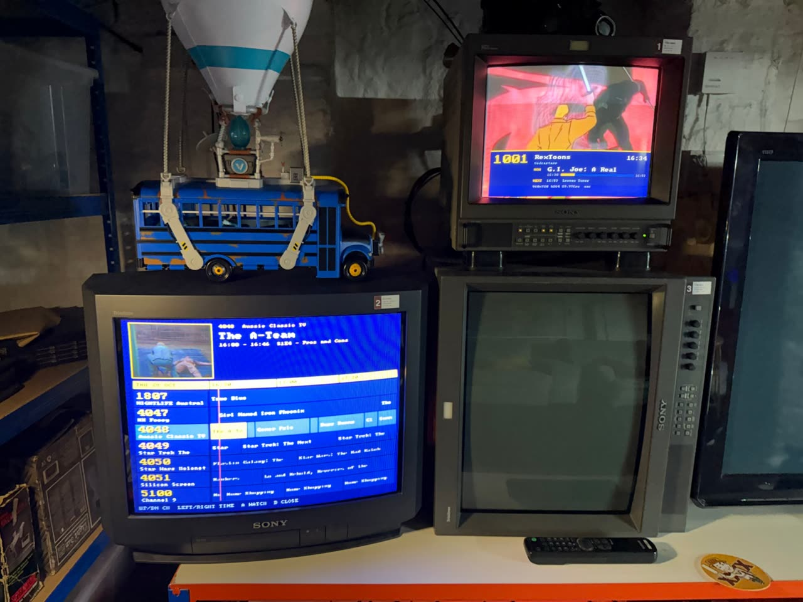
  </a>
  <br>
  <a href="https://youtu.be/OCvExU21ayg"><b>▶ Watch the demo:</b> two CRTs, one Raspberry Pi 5, 90s cable TV</a>
</p>

<p align="center">
  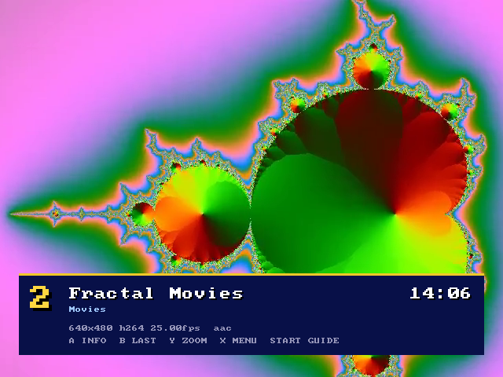
  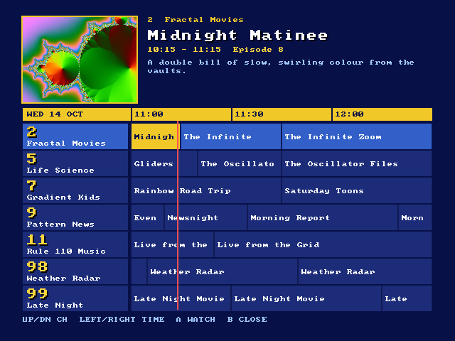
</p>

> The screenshots use RetroTV's demo line-up: made-up channels with
> FFmpeg-generated pictures (`tests/demo/`). With your own playlist you'll see
> your channels.

## Features

- **Channel surfing:** up/down, last channel, channel list, static and hiss while tuning, NO SIGNAL
- **Now / Next banner** and a **TV guide** (90-minute grid, live preview, programme details) from your XMLTV guide
- **Picks up where you left off:** remembers the last channel you watched
- **Made for CRTs:** 4:3, 50 Hz on 25/50 fps channels (smooth PAL), optional **240p**, overscan margin
- **Zoom button** to fill the screen with letterboxed 16:9 pictures, remembered per channel
- **Pause** a live channel for up to about 15 minutes and carry on where you left off, or jump back to live
- **Volume leveller** so loud and quiet channels sound alike
- **Sleep timer**, audio track choice, **colour themes** and a VHS tuning look
- **Remote control** over HTTP: tune a channel from Zaparoo, a script or a phone
- **Built-in test card** and a setup screen that explains what's wrong in plain words
- Works with **Dispatcharr**, **Tunarr** or any M3U playlist with MPEG-TS or HLS streams

## Install

You need **ReplayOS 2.1.0 or newer on a Raspberry Pi 5**, with internet access. RetroTV
installs as its own system: **RetroTV** in ReplayOS's system list.

**Option 1: one line over SSH** (ReplayOS's root password is `replayos` unless you changed it):

```bash
ssh root@replay.local
```
```bash
curl -fsSL https://raw.githubusercontent.com/chris-skitch/retrotv-libretro/main/install.sh | bash
```

**Option 2: from the TV, no SSH.** Copy
[`replayos/retrotv_update.sh`](replayos/retrotv_update.sh) to `roms/_extra/` on your
ReplayOS storage (the SD card, USB drive or network share), then run
**Extra → retrotv_update.sh**.

Either way, the installer:
- downloads the latest release and checks its SHA-256 sums;
- installs the core and registers it as a ReplayOS system
  (`/opt/replay/cores/retrotv_libretro.cfg`), with `roms/retrotv/RetroTV.txt` as its first line-up;
- copies the core to `<storage>/retrotv/` and creates a commented `playlist.txt` there if you don't have one;
- adds **retrotv_update.sh** and **retrotv_uninstall.sh** to Extras;
- restarts ReplayOS.

Older RetroTV versions borrowed ReplayOS's A/V test or Virtual Boy slot. The installer moves
such an install over: the slots get their own cores back, and your settings (two screens
too) and last channel come along.

Then:

1. Open `retrotv/playlist.txt` on your storage and put your playlist link on its own line (see below).
2. On the TV, open **RetroTV** in the system list (an orange folder, like every external
   system), then **RetroTV** inside it.

**Updates from the TV.** RetroTV checks GitHub once a day for a newer version (turn it off
with **System Settings → Updates → Check for updates**). When there is one, the channel banner
says so, and **X → Update → Install** downloads and installs it, without restarting ReplayOS:
the new version starts the next time you open RetroTV. The phone remote shows an INSTALL
button too, and `/update` reports it (`?check=1` checks now, `?install=1` installs). Installing is
always your choice. It runs the release's own installer, which checks the SHA-256 sums first.

You can also update with **Extra → retrotv_update.sh**. **Uninstall** with
**Extra → retrotv_uninstall.sh**. ReplayOS updates keep RetroTV installed.

## Your channels: `playlist.txt`

The first line that doesn't start with `#` is your channel list: an M3U link or
the full path to an `.m3u` file.

```
# Dispatcharr (a channel profile)
http://<dispatcharr>:9191/output/m3u/<channel-profile>

# or Tunarr
http://<tunarr>:8088/api/channels.m3u
```

**More than one line-up.** The RetroTV system lists the files in
`roms/retrotv/` as its games. The installer adds `RetroTV.txt`, which uses
`retrotv/playlist.txt`. Add more files for more line-ups, each with its own last channel:
a `.txt` written like `playlist.txt` (a link, and optionally `epg=`), or an `.m3u` file.

**TV guide.** RetroTV uses the guide link in the playlist (`x-tvg-url`)
automatically. To use a different guide, or if your playlist has none, add an
`epg=` line with an XMLTV link or path (`.xml` or `.xml.gz`):

```
epg=http://example.org/guide.xml.gz
```

Guide listings are matched to channels by `tvg-id`, then by channel name (so a
guide from another source works), then by channel number.

If something's wrong, RetroTV shows a setup screen that says what happened
(server not found, 404, not a playlist, ...) and where the file is. Press **A**
there for the test card, which checks picture, sound and stereo.

<p align="center">
  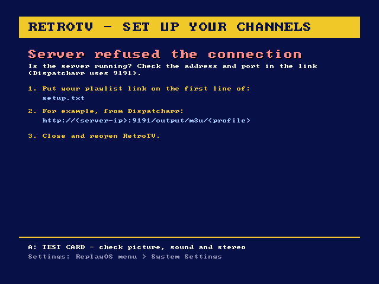
  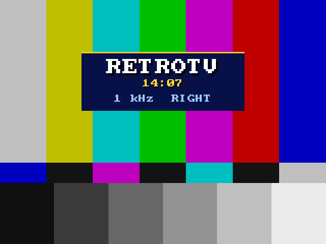
</p>

## Controls

Button names are the labels on an Xbox-style pad.

| Button | Action |
|---|---|
| Up / Down (or R / L) | Channel up / down |
| A | What's on (banner) |
| B | Last channel |
| Y | Zoom: letterboxed (Fit) or fill the screen (Zoom), remembered per channel |
| X | Menu: pause / back to live, sleep timer, audio track, volume leveller, Fit/Zoom, 480/240p, update, test card, controls (with two screens: Screen 2 on/off and Swap screens instead of 480/240p) |
| Start | TV guide: Up/Down channel, Left/Right 30 minutes, A to watch, B to close |
| Select | Channel list: Up/Down one channel, Left/Right a page, A to watch, B to close |
| R2 / L2 | Pause (a VCR-style still frame, or a clean still: *Paused picture* option) and play on (the channel keeps arriving in memory: up to about 15 minutes at 8–10 Mbit/s, less with both screens paused; it plays on by itself when full) / back to live. Also in the X menu |
| Left / Right | With [two screens](#two-screens): move the focus (and the sound) to screen 1 / screen 2 |

<p align="center">
  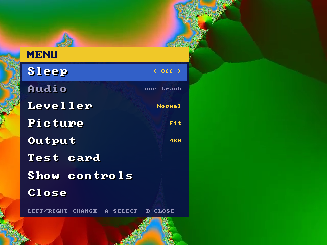
  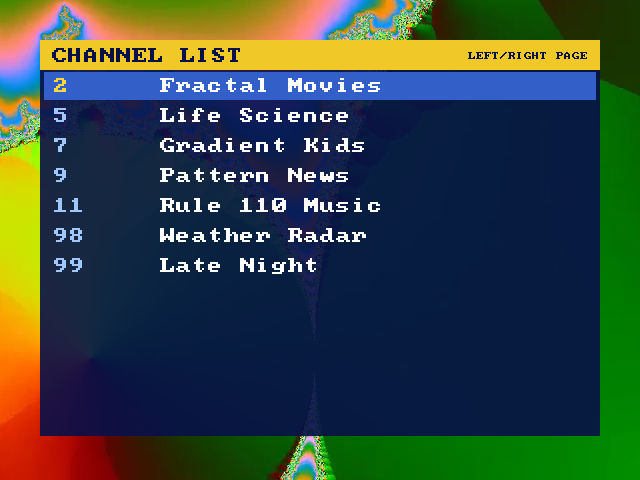
  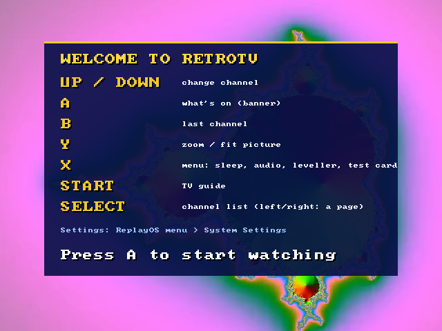
</p>

<p align="center">
  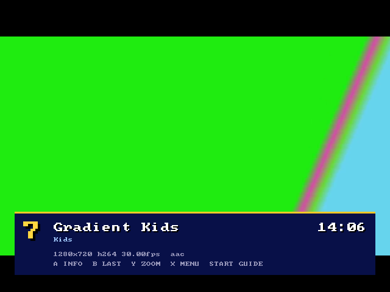
  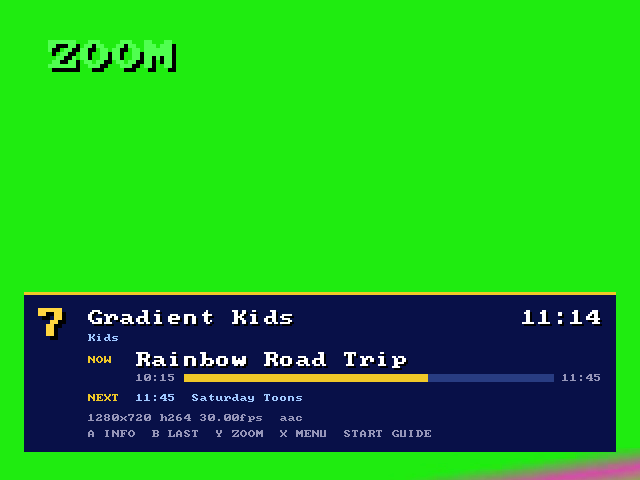
  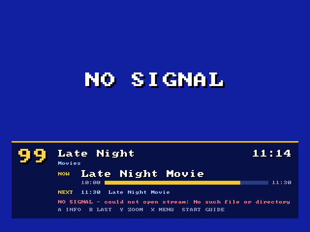
</p>

## Settings

**System Settings** is in the ReplayOS in-game menu. That's where you set your
defaults, and ReplayOS saves them. The **X menu** is for quick changes while you
watch: they apply immediately and last until you quit.

| Group | Setting | Choices |
|---|---|---|
| Picture | Overscan margin | None, 5 %, 10 % (shrinks the video so its edges stay visible) |
| | Picture | Fit, Zoom (default for channels you haven't zoomed) |
| | Remember zoom per channel | On, Off |
| | Output | 640x480, 640x240 (240p) |
| | Two screens (dual mode) | Off, On (needs ReplayOS Multi screen = Dual horizontal for RetroTV) |
| | Refresh rate | Auto (50 Hz for 25/50 fps channels), 60 Hz, 50 Hz |
| Sound | Volume leveller | Normal, Loud, Off |
| | Tuning static sound | Normal, Quiet, Off |
| | Channel-change sound | Off, On |
| Interface | Banner timeout | 2, 4, 8 seconds, Off |
| | Clock | 24-hour, 12-hour |
| | Button hints | On, Off |
| | Colour theme | Cable Navy, Teletext, Green Phosphor |
| | Tuning picture | Classic snow, VHS |
| | Paused picture | VHS tape (a VCR's shaky still frame with a noise bar), Still picture |
| Remote control | Remote control | This device only, Home network, Off |
| | Tell Zaparoo what's on | On, Off |
| Updates | Check for updates | On, Off |

<p align="center">
  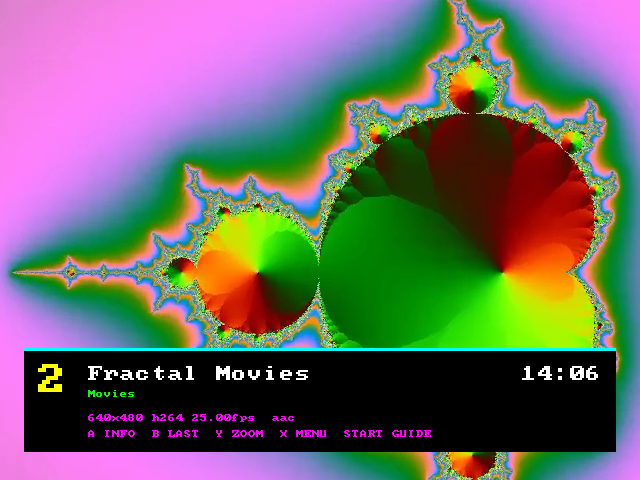
  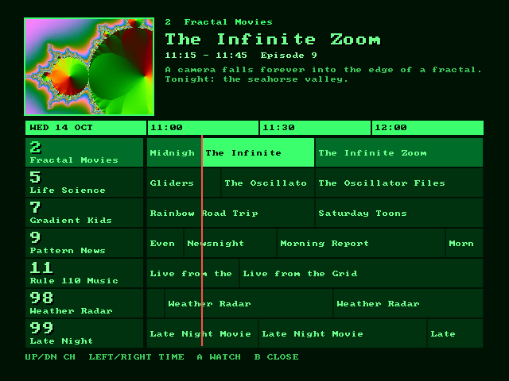
  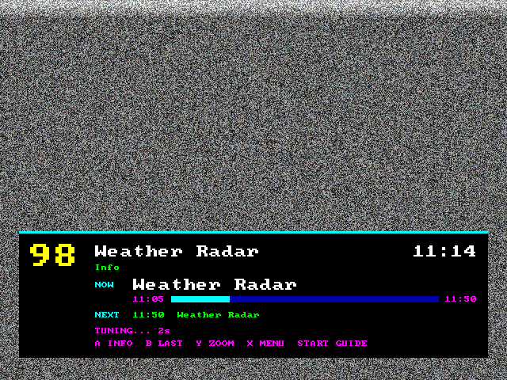
</p>

### 240p

**System Settings → Picture → Output → 640x240 (240p)**, or **X → Output**.
ReplayOS switches the CRT to a progressive 240-line mode (2560x240), like an old
console: no interlace flicker, half the vertical detail. Video lines are blended
in pairs, and the menus are drawn at 240 lines so the text stays sharp. It's off
by default because TV broadcasts look best at 480 lines.

<p align="center">
  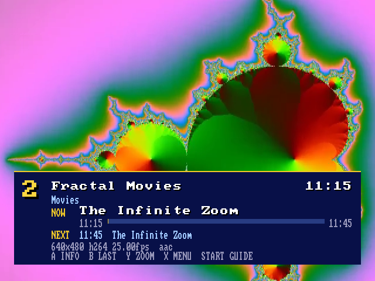
  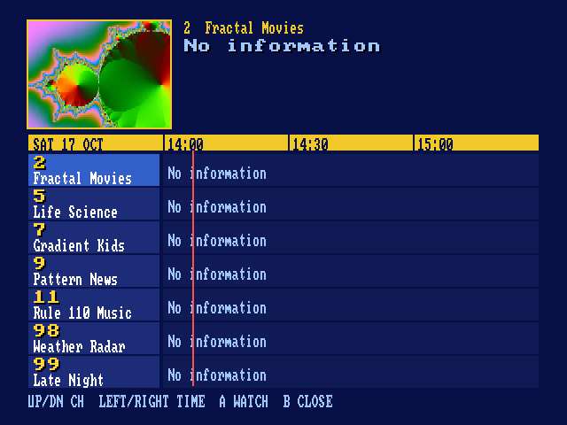
</p>

## Two screens

With two CRTs on the Pi 5's two HDMI ports, RetroTV can play a channel on each.

<p align="center">
  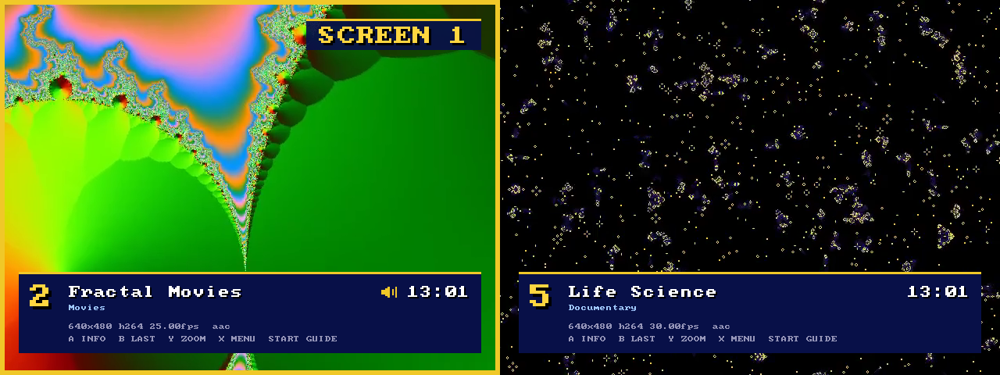
</p>

**Setting up (once):**
1. Connect **both** screens **before** switching the Pi on. ReplayOS sets up dual output at start; a
   screen plugged in later makes the main CRT flash until a reboot.
2. Open RetroTV, go to **System Settings → Picture → Two screens (dual mode) → On**, save, and quit RetroTV.
3. Open RetroTV again. In the ReplayOS in-game menu, **Replay Options → Multi screen → Dual horizontal**,
   then **Save system settings**, so only RetroTV uses it (your games keep their own setting). Quit
   and open RetroTV once more. Keep the global Multi screen on **Dual smart** or off: as the global
   setting, Dual horizontal makes the main CRT flicker in everything.
4. Be careful with ReplayOS's autostart here: on ReplayOS 2.0.60, autostarting a game with its own
   Dual horizontal setting crashed ReplayOS at start-up. It hasn't been retried on 2.1.

**Using it:**
- **X → Screen 2: On** turns screen 2 on (on its last channel) and gives it the focus. **Off** shows a
  standby card there, which moves every few seconds so it can't burn into the CRT.
- **Left / Right** move the focus between screen 1 and screen 2: a gold frame and "SCREEN 1/2" show
  where it is. The screen with the focus is the one you **hear**, and the one the remote, banner, X
  menu, zoom, channel list and guide act on. A small speaker on the banner marks it too.
- **X → Swap screens** swaps the two channels; you keep hearing the screen you were on.
- Screen 2's channel and on/off are remembered. B (last channel) works per screen.
- In dual mode the picture is a fixed 1280x480 at 60 Hz, or **1280x240 (240p on both screens)**
  with **System Settings → Picture → Output → 640x240**. Change it there and reopen RetroTV: it
  isn't switched while running, and 50 Hz switching is off. ReplayOS then sends both CRTs a
  progressive 240p mode instead of 480i, which some TVs and HDMI-to-SCART adapters hold better.
  Sound comes from the main screen's HDMI.
- If both screens play at half speed (smooth but stuttery, every channel), ReplayOS's two outputs
  started out of step: reopen RetroTV. Each start is a new roll; RetroTV notes it in
  `/tmp/retrotv.log` ("out of step"). Switching sizes while running made this a coin toss, which
  is why the size is fixed.
- With two screens connected, anything that changes the display mode can leave the main CRT
  flickering (and silent) until a reboot: plugging a screen in, a 50 Hz switch from RetroTV
  with two screens off, or ReplayOS crashing and restarting. A reboot clears it.
- Each screen is its own stream, so two channels use two connections to your server.

## Remote control

While RetroTV is playing, it answers simple web requests on port **7474**.

**On your phone:** set **System Settings → Remote control → Home network**, then
open `http://<your-pi>:7474/` in the browser (add it to your home screen for one
tap). You get the channel on now; CH up/down, LAST, PAUSE/PLAY and LIVE buttons; with
two screens, SCREEN 1 / SCREEN 2 and SWAP; and every channel with what's on now and
next, with the programme's picture from the guide (or the channel logo). Tap a channel
to watch it, or search by channel or programme. The ⚙ button opens the quick settings:
sleep timer, audio track, volume leveller, Fit/Zoom and 480/240p, the same as the X menu
on the TV (with two screens, for either screen). When a newer RetroTV is out, an INSTALL
button appears.

<p align="center">
  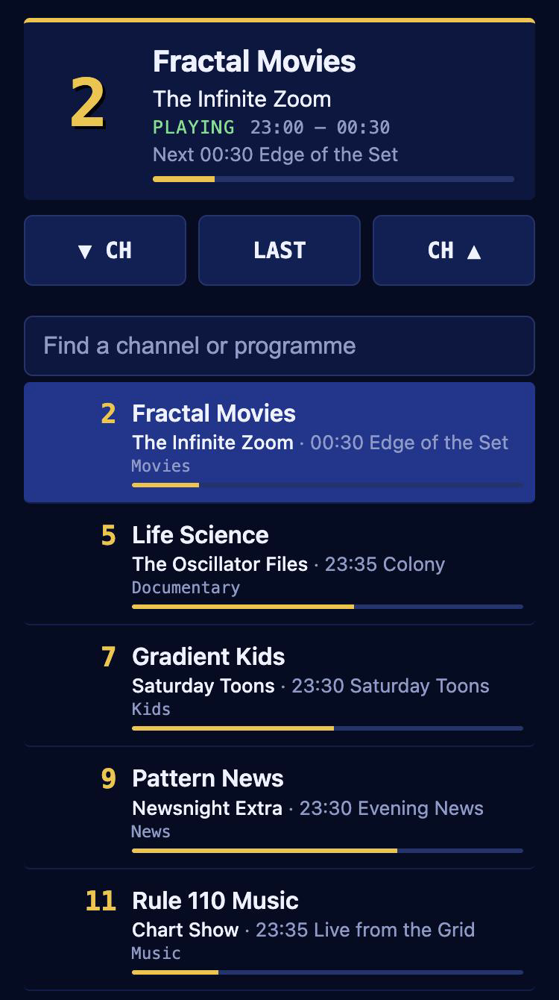
</p>

| Request | Does |
|---|---|
| `/` | the remote control page |
| `/tune?ch=36` | tune channel 36 (the number shown on the banner) |
| `/tune?name=star+trek` | tune by name: exact first, else the first name that contains it |
| `/up`, `/down`, `/last` | channel up, down, previous |
| `/pause`, `/play`, `/live` | pause the channel (it keeps arriving in memory, up to about 15 minutes), play on from there, or go back to live. `/status` shows `paused` and `behind` (seconds) |
| `/status` | what's on, as JSON: channel, name, state, programme now and next |
| `/channels` | every channel (number, name, group, logo) with Now/Next, their times and poster images, as JSON |
| `/settings` | sleep timer, audio track, volume leveller, picture and output, as JSON |
| `/set?sleep=30&leveller=loud` | change settings: `sleep` (0, 15, 30, 60, 90), `audio` (track 1, 2, ...), `leveller` (off, normal, loud), `picture` (fit, zoom), `output` (480, 240) |
| `/help` | this list, as text |
| `screen=1` / `screen=2` | with two screens: add to `/tune`, `/up`, `/down`, `/last`, `/pause`, `/play`, `/live` to pick the screen (default: the focused one) |
| `/settings?screen=2`, `/set?picture=zoom&screen=2` | with two screens: read or change that screen's picture (Fit/Zoom), volume leveller and audio track without moving the focus or the sound. The reply has `"screen": 2`. Each screen keeps its own leveller, used while it has the focus. `sleep`, `output` and `screen2` always apply to the whole box |
| `/focus?screen=2` | move the focus (and the sound) to screen 2 |
| `/set?screen2=on` | turn screen 2 on or off |
| `/swap` | swap the two screens' channels; you keep hearing the screen you were on (X → Swap screens) |
| `/update` | is a newer RetroTV out? `?check=1` checks now, `?install=1` installs it (see [Install](#install)) |

```bash
curl http://127.0.0.1:7474/tune?ch=36
```

A remote tune works like the remote control: it closes any menu, wakes the set
from the sleep timer, and on the channel already playing just shows the banner.

- **Zaparoo:** write `**http.get:http://127.0.0.1:7474/tune?ch=36` to a tag or
  card, and tapping it switches channel. (Zaparoo's virtual gamepad works too: RetroTV
  takes buttons from players 1-4.)
- **Who can use it:** **System Settings → Remote control**. *This device only*
  (default) accepts requests from the Pi itself, such as Zaparoo or a script.
  *Home network* also lets phones and computers on your network change channel,
  with no password, so only use it on a network you trust. *Off* turns it off.

## Remote start and Zaparoo

RetroTV can be started from anywhere on the Pi, without autostart or restarting ReplayOS:

```bash
bash /media/sd/retrotv/retrotv_launch.sh 36
```

starts RetroTV if it isn't running (through ReplayOS's own API) and tunes
channel 36; when RetroTV is already on, it just changes channel. Leave the number
off to only start it. The launcher lives on the SD card on purpose: when ReplayOS
restarts it remounts network storage, and a script running from there would block it.

**[Zaparoo](https://zaparoo.org)** (if installed) gets two things from the installer:
- **RetroTV as a system** in the Zaparoo App: pick it or write it to a card to start
  RetroTV. Like every Zaparoo launch on ReplayOS, this first stops what's playing,
  which restarts ReplayOS.
- **Channel cards**, which tune without restarting anything: write the ZapScript
  `**execute:bash /media/sd/retrotv/retrotv_launch.sh 36` to a card. The installer
  adds the matching `allow_execute` rule to Zaparoo's `config.toml` (backup in
  `config.toml.before-retrotv`).

Zaparoo doesn't recognise RetroTV's core, so RetroTV tells it what's on itself: the
Zaparoo app shows the channel you're watching (e.g. *Video · RetroTV: 36 Star Trek*), and
those channels in its history and recents launch again. Turn it off with **System
Settings → Tell Zaparoo what's on**. Write channel cards with the ZapScript above, not the
app's "write what's playing" (that card wouldn't tune).

**Start RetroTV with ReplayOS** (a cable box that comes on with the TV): use ReplayOS's
autostart with the line-up's path, `/roms/retrotv/RetroTV.txt` (relative to your storage,
starting with `/`). See the caution under [Two screens](#two-screens) first.

## Servers

- **Dispatcharr:** use a **Channel Profile** to choose which channels RetroTV
  shows: `/output/m3u/<profile>`. The guide (`/output/epg/<profile>`) comes along
  automatically. Allow the Pi under Dispatcharr's network access for M3U/EPG.
  RetroTV doesn't use Dispatcharr's API and needs no key.
- **Tunarr:** use `/api/channels.m3u`, not `/stream/channels/N.m3u8` (that's a
  single channel's video). The guide comes along.
- **Anything else:** an M3U with HTTP(S) MPEG-TS or HLS streams. Add `epg=` for a guide.

## Troubleshooting

- **RetroTV isn't in the system list:** it needs ReplayOS 2.1.0 or newer, and
  **Visibility → Show external systems** on. ReplayOS logs why a registration was
  rejected in `/var/log/replay.log` (set **System → Log level → Warn** first).

- **Setup screen instead of channels:** it says what's wrong. Check the link in
  `playlist.txt` from another computer.
- **No guide:** check the playlist has `x-tvg-url`, or add `epg=`.
- **A channel stays on TUNING:** cold IPTV channels can take 5–10 s, and RetroTV
  retries 3 times before NO SIGNAL.
- **Log:** `/tmp/retrotv.log` on the Pi (`ssh root@replay.local`).

## Build

```bash
pip install ziglang==0.13.0
make deps && make test && make
```

This cross-builds `build/retrotv_libretro.so` for the Pi 5 (aarch64) and runs
the host unit tests. Releases are built by CI when a `v*` tag is pushed. For
development (tests on the Pi, the screenshot demo, architecture), see
[CLAUDE.md](CLAUDE.md), [docs/ROADMAP.md](docs/ROADMAP.md) and
[docs/DESIGN.md](docs/DESIGN.md).

## AI transparency

This project was developed with significant AI assistance (primarily Claude by
Anthropic). The author reviews, understands, tests, and maintains all code. See
[AI_POLICY.md](AI_POLICY.md) for contribution guidelines.

---

MIT licensed. Third-party code: `include/libretro.h` (MIT, The RetroArch team)
and `src/font8x8_basic.h` (public domain, Daniel Hepper / IBM VGA font). Not
affiliated with ReplayOS, libretro, Dispatcharr or Tunarr.
